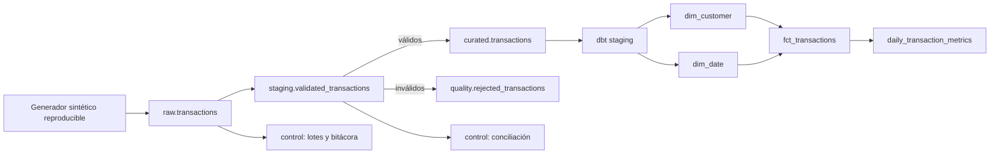

# Portafolio de ingeniería de datos - Eva Cruz Valdovinos

Dos demostraciones nuevas y reproducibles de ingeniería de datos con Python, SQL, DuckDB y dbt. Todos los datos son sintéticos y todo se ejecuta localmente sin servicios de pago.

> **Alcance honesto:** este repositorio es un proyecto de portafolio. No contiene código, datos, tablas, reglas, capturas ni documentos de empleadores. No representa una implementación productiva. La arquitectura Azure está documentada como propuesta, no como despliegue probado.

## Proyectos

| Proyecto | Qué demuestra | Acceso |
|---|---|---|
| Pipeline incremental y calidad | raw/staging/curated, validaciones, rechazos, upsert, idempotencia, recuperación, bitácora y conciliación | [README del pipeline](projects/pipeline/README.md) |
| Modelado analítico con dbt | staging, dimensiones, hechos, métricas, documentación y 34 pruebas dbt | [README de analytics](projects/analytics_dbt/README.md) |

La [presentación del portafolio](docs/index.md) enlaza ambos proyectos. La [evidencia local](evidence/validation_summary.md) contiene resultados reales con fecha y entorno.

## Arquitectura integrada



## Inicio rápido en Windows PowerShell

Requisito: Python 3.12 y Git.

```powershell
py -3.12 -m venv .venv
.\.venv\Scripts\python.exe -m pip install -r requirements.txt
$env:PYTHONPATH="$PWD\src"
.\.venv\Scripts\python.exe scripts\validate_portfolio.py
```

El último comando parte de salidas vacías, ejecuta pytest, los tres lotes, la falla simulada, el reproceso idempotente, dbt normal, dbt negativo y una restauración dbt final. Genera:

- `evidence/validation_summary.md`
- `evidence/validation_summary.json`
- `evidence/quality_report.html`
- `projects/pipeline/data/portfolio.duckdb` (reproducible, excluido de Git)
- `projects/analytics_dbt/target/` (documentación dbt generada, excluida de Git)

En macOS/Linux, sustituye las dos primeras líneas por:

```bash
python3.12 -m venv .venv
.venv/bin/python -m pip install -r requirements.txt
PYTHONPATH=src .venv/bin/python scripts/validate_portfolio.py
```

## Ejecución por proyecto

```powershell
$env:PYTHONPATH="$PWD\src"
.\.venv\Scripts\python.exe -m portfolio_pipeline demo
Set-Location projects\analytics_dbt
..\..\.venv\Scripts\dbt.exe build --profiles-dir .
```

Para demostrar el control negativo de relaciones:

```powershell
..\..\.venv\Scripts\dbt.exe build --profiles-dir . --vars '{inject_invalid_relationship: true}'
```

Ese comando **debe fallar** en dos pruebas `relationships`; después ejecuta otra vez el build normal para restaurar el estado válido.

## Estado verificado

- Pipeline y pytest: probado localmente.
- dbt-duckdb: probado localmente, incluyendo un fallo negativo esperado y restauración.
- DAG de Airflow: preparado y validado sintácticamente; Airflow no se instaló ni ejecutó.
- Azure Data Factory, Databricks y Synapse: diseño documentado; no desplegado ni probado en Azure.
- GitHub Actions: validación aprobada el 9 de octubre de 2026; consulta el historial en la pestaña Actions.
- Eliminaciones de negocio: fuera de alcance. El pipeline solo procesa altas y modificaciones; una versión tardía anterior a la vigente se rechaza como `LATE_STALE_VERSION`.

## Diseño y documentación

- [Diccionario de datos](docs/data_dictionary.md)
- [Arquitectura Azure propuesta](docs/architecture_azure.md)
- [Guía para entrevista](docs/interview_guide.md)
- [Perfil de GitHub propuesto](docs/github_profile.md)
- [Manifiesto público exacto](docs/public_manifest.md)
- [Lista de comprobación para publicar](docs/publication_checklist.md)
- [Asistencia y autoría](ASSISTANCE.md)

## Privacidad

No se incluyen teléfono, domicilio, correo personal, fotografía ni CV. Antes de publicar, revisa el [manifiesto público](docs/public_manifest.md) y el resultado de `git status`. No agregues archivos `.env`, credenciales, bases DuckDB, CV ni datos reales.

## Licencia

Pendiente de elección. Este paquete no incluye un archivo `LICENSE`; se agregará uno solo después de que Eva conozca su alcance y lo autorice expresamente.
