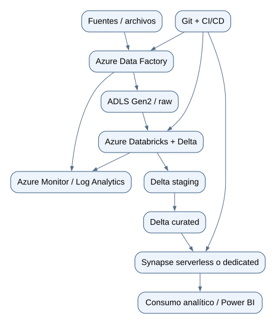

# Traslado propuesto a Azure

Esta sección es un diseño, no un despliegue. No se crearon recursos ni se generaron cargos.

[Ampliar diagrama](assets/architecture_azure.svg) · [Fuente Mermaid](assets/architecture_azure.mmd)

## Equivalencia de componentes

| Demostración local | Propuesta Azure |
|---|---|
| CSV generado | fuente aterrizada en ADLS Gen2 |
| Python CLI | notebooks/jobs PySpark en Databricks |
| DuckDB raw/staging/curated | tablas Delta con Bronze/Silver/Gold |
| `batch_registry` y watermark | tabla de control Delta o Azure SQL |
| transacción local | escritura Delta ACID y promoción por job |
| dbt-duckdb | dbt con adapter Databricks o Synapse, según destino |
| CLI secuencial / DAG preparado | ADF para dependencias, triggers, reintentos y parámetros |
| reporte HTML local | métricas operativas en Log Analytics y tablero de calidad |

## Papel de Azure Data Factory

ADF recibiría parámetros como `batch_id`, ruta y fecha de corte; validaría disponibilidad, invocaría Databricks, evaluaría conteos de salida, registraría el estado y activaría dbt/Synapse solo tras una conciliación correcta. Los reintentos serían acotados y la clave de idempotencia seguiría siendo lote + checksum.

## Databricks y Delta

PySpark realizaría tipado y reglas a escala. Delta permitiría `MERGE` por `transaction_id`, control de concurrencia, historial y recuperación. Las filas rechazadas conservarían lote, fila y motivos. `source_updated_at` seguiría ordenando versiones; para CDC real habría que acordar semántica de deletes y eventos fuera de orden.

## Synapse

Synapse expondría modelos dimensionales para consumo. Serverless es suficiente para exploración sobre Delta/Parquet; un pool dedicado tendría sentido solo con carga, concurrencia y SLA que lo justifiquen. La elección requiere pruebas de volumen y costo que este portafolio no realizó.

## CI/CD y seguridad

- Infraestructura como código y entornos separados.
- Identidades administradas, Key Vault y mínimo privilegio; nunca secretos en Git.
- Pruebas unitarias, dbt build y validación de contratos antes del despliegue.
- Aprobaciones para producción, rollback versionado y monitoreo de frescura/calidad.
- Particionado, tamaño de archivos y optimización se decidirían con datos reales, no por anticipación.
