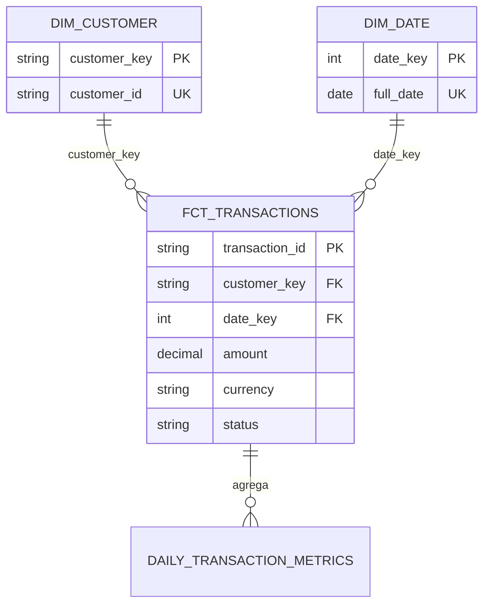

# Proyecto 2 - Modelado analítico con dbt y DuckDB

> Demostración de portafolio sobre datos sintéticos producidos por el Proyecto 1. No fue desplegada en Azure.

## Problema y alcance

El proyecto transforma la capa `curated.transactions` en un modelo dimensional documentado y probado. Usa dbt-duckdb para mantener SQL versionado, dependencias explícitas y validaciones repetibles.

## Modelo



### Granos

- `stg_transactions`: una fila por `transaction_id`, última versión curated.
- `dim_customer`: una fila por cliente sintético.
- `dim_date`: una fila por fecha observada.
- `fct_transactions`: una fila por transacción.
- `daily_transaction_metrics`: una fila por fecha, moneda y estado.

### Métricas

- `transaction_count`: número de transacciones del grano agregado.
- `gross_amount`: suma de `amount`, sin conversión de moneda.
- `average_amount`: promedio de `amount`.
- El análisis `business_metrics.sql` separa conteos e importes completados y reembolsados por moneda.

## Ejecutar

Primero ejecuta el pipeline desde la raíz. Luego:

```powershell
Set-Location projects\analytics_dbt
..\..\.venv\Scripts\dbt.exe debug --profiles-dir .
..\..\.venv\Scripts\dbt.exe build --profiles-dir .
..\..\.venv\Scripts\dbt.exe docs generate --profiles-dir .
..\..\.venv\Scripts\dbt.exe docs serve --profiles-dir .
```

`docs serve` abre un servidor local; no publica datos en Internet.

## Pruebas

El build normal comprueba unicidad, no nulos, relaciones, valores permitidos y una prueba SQL para importes/estados inválidos. El modo negativo agrega temporalmente una transacción con claves huérfanas:

```powershell
..\..\.venv\Scripts\dbt.exe build --profiles-dir . --vars '{inject_invalid_relationship: true}'
```

Se espera que falle en las relaciones hacia `dim_customer` y `dim_date`. Ejecuta luego el build normal para restaurar las tablas. La [evidencia local](../../evidence/validation_summary.md) registra tanto la detección como la restauración.

## Dependencias y documentación

`ref()` y `source()` construyen el DAG. Los archivos `schema.yml` contienen descripciones y pruebas. `dbt docs generate` produce el catálogo y el linaje navegable en `target/`.

## Limitaciones

- Datos pequeños y locales; no prueba rendimiento distribuido.
- La dimensión cliente es tipo 1 y solo contiene atributos derivados del ejemplo.
- No hay conversión cambiaria, calendario completo ni información personal.
- La migración a Azure está propuesta en [arquitectura Azure](../../docs/architecture_azure.md), no ejecutada.
